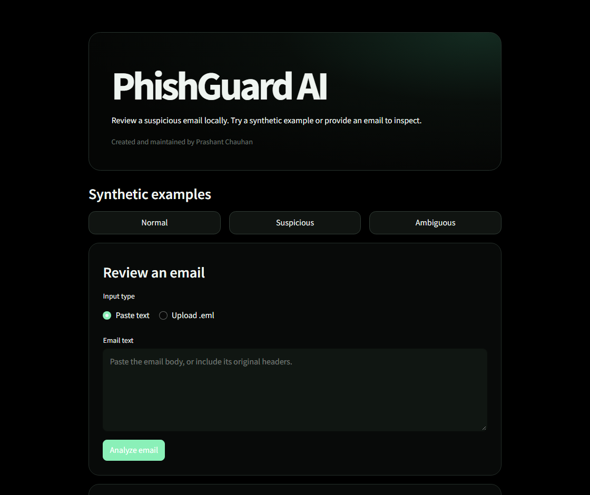
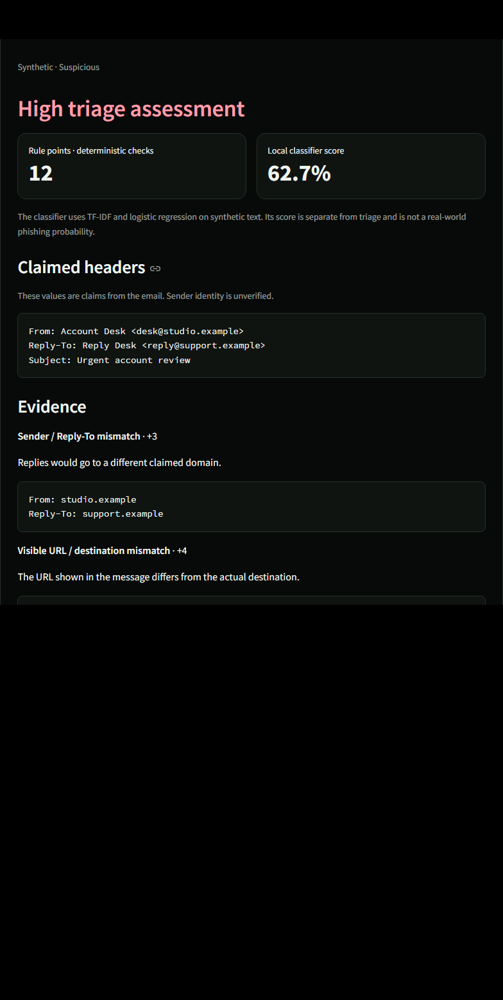

# PhishGuard AI

PhishGuard AI helps reviewers triage suspicious email locally. It shows the email's claimed headers, evidence for each rule, and a separate synthetic-data classifier score.

Author and maintainer: [Prashant Chauhan](https://github.com/itsprshnt20)

Planned repository: [itsprshnt20/PhishGuard-AI](https://github.com/itsprshnt20/PhishGuard-AI)

## Screenshots

**OLED dashboard** — choose a synthetic example, paste email text, or upload an .eml file.



**Suspicious demo** — inspect the High triage assessment, claimed headers, and the visible URL alongside its actual destination.




## Features

- Paste plain text or upload an `.eml` file with a plain-text or HTML body. Multipart messages are supported.
- Review claimed From, Reply-To, and Subject values and inspect visible link labels alongside actual destinations.
- See why the deterministic rules assigned Low, Review, or High. Missing and unusable claims are shown as uncertainty.
- Compare a separate local TF-IDF and logistic regression classifier score, or continue with rules when the model is unavailable.
- Try three synthetic examples and download a Markdown report with the claimed headers, uncertainty, assessment, and evidence excerpts.

## Install and run on Windows

Open PowerShell inside the extracted `PhishGuard-AI` folder with 64-bit Python 3.11 installed.

```powershell
py -3.11 -m venv .venv
.\.venv\Scripts\python.exe -m pip install -r requirements.txt
.\.venv\Scripts\python.exe -m streamlit run app.py
```

Open [http://127.0.0.1:8501](http://127.0.0.1:8501) if the browser does not open automatically. The install downloads pinned packages from PyPI, including numerical and Streamlit dependencies. Runtime uses the bundled data and listens on loopback with Streamlit usage statistics disabled. Email HTML is parsed as data. The app does not visit extracted URLs, load email images, or send imported content to a service. Inputs remain in session memory and reports are generated on demand.

## Two-minute walkthrough

1. Click **Normal** for **Low · 0 points** and a complete set of claims with matching domains.
2. Click **Suspicious** for **High · 12 points**. The synthetic email claims `studio.example` in From and `support.example` in Reply-To. It displays `https://studio.example/review` while the actual destination is `https://support.example:8443/review`. The unusual port and urgent password request also appear as evidence.
3. Open **Extracted links** to see both values as plain code text. Click **Download Markdown report** to save the findings. The report omits the full body and can include short excerpts used as evidence.
4. Click **Ambiguous** for **Review · 0 points**. From and Reply-To are Unknown and no mismatch fires.
5. Paste `Can you review the meeting notes?` for **Review · 0 points** because the headers are missing. Or select **Upload .eml**, choose `samples/suspicious.eml`, and click **Analyze email** to repeat the multipart example through the upload flow.

## Architecture

```text
Paste / .eml upload / synthetic sample
                |
           MIME parser
                |
        headers, body, links
          /            \
 deterministic rules   local TF-IDF + logistic regression
          \            /
        Streamlit results + Markdown report
```

## Triage scoring

| Rule | Points | Condition |
| --- | ---: | --- |
| Sender / Reply-To mismatch | 3 | Both fields contain a usable single-mailbox claim and their case-insensitive domains differ. |
| Visible URL / destination mismatch | 4 | An HTML link displays a complete HTTP(S) URL whose text differs from its actual href. |
| Unusual URL structure | 2 | The destination contains userinfo, a literal IP, an internationalized domain label, a non-default port, or is malformed, relative, or a non-web scheme. |
| Urgent credential or payment request | 3 | The subject and body contain a configured time-pressure phrase and a sensitive request pattern. |

Each rule contributes points once per email, even when multiple findings are shown. **High** means 6 or more points. **Review** means 1–5 points, or 0 points with a missing header or unusable address claim. **Low** means 0 points and all assessed claims are present and usable. Header claims can be forged. Treat the result as triage guidance and interpret each finding in context.

## Classifier and evaluation

The bundled synthetic CSV contains 24 original examples. The fixed family split uses 18 for training and 6 for evaluation. Family IDs keep related variants in the same partition. TF-IDF uses word unigrams and bigrams. Logistic regression fits on training text only and displays its phishing-class score for the email subject plus body. The rule score and risk level are independent of the model.

```powershell
.\.venv\Scripts\python.exe model.py
```

Measured on the six synthetic held-out examples using the pinned environment: **6/6 correct**, **1.000 accuracy**, and **1.000 phishing F1**. The confusion matrix contained 3 true negatives, 3 true positives, and no errors. These examples are small, balanced, and synthetic. They do not establish real-world accuracy or calibration.

## Tests

```powershell
.\.venv\Scripts\python.exe -m unittest discover -s tests -v
```

For the optional browser smoke check, start the app as above in one terminal and run these commands in a second terminal. Playwright downloads Chromium headless shell and its supporting tools at install time.

```powershell
.\.venv\Scripts\python.exe -m pip install playwright==1.65.2
.\.venv\Scripts\python.exe -m playwright install chromium --only-shell
.\.venv\Scripts\python.exe tests/browser_smoke.py
```

## Known limitations

- Inputs are limited to **1 MiB** and **100 MIME parts**. Attachments and embedded emails are skipped. Parsing supports readable `text/plain` and `text/html` parts and may show both alternatives in the body preview.
- Domain comparisons use claimed mailbox domains. There is no SPF, DKIM, DMARC, DNS, redirect, or reputation lookup.
- URL mismatch compares text to the href directly. Legitimate formatting changes, tracking links, and relative destinations can trigger evidence. The HTML text preview does not simulate email client rendering.
- Request detection uses a small English phrase set. It can miss new phrasing, obfuscation, image-only content, and non-English requests.

## GitHub handoff

Repository description: Local Streamlit email triage with offline MIME and link inspection, explainable rules, a synthetic-data classifier, and Markdown reports.

Resume bullet: Built PhishGuard AI, a local Streamlit email triage app with multipart MIME parsing, explainable risk rules, Markdown export, and a TF-IDF classifier evaluated on six held-out synthetic emails.

Optional publication commands, from the project root, after creating an empty GitHub repository:

```powershell
git init -b main
git add .
git commit -m "Add PhishGuard AI"
git remote add origin https://github.com/itsprshnt20/PhishGuard-AI.git
git push -u origin main
```

## License

Original source and synthetic samples are under the [MIT License](LICENSE). Dependencies and browser testing tools are installed separately under their own licenses. The source archive includes no third-party packages or assets.
